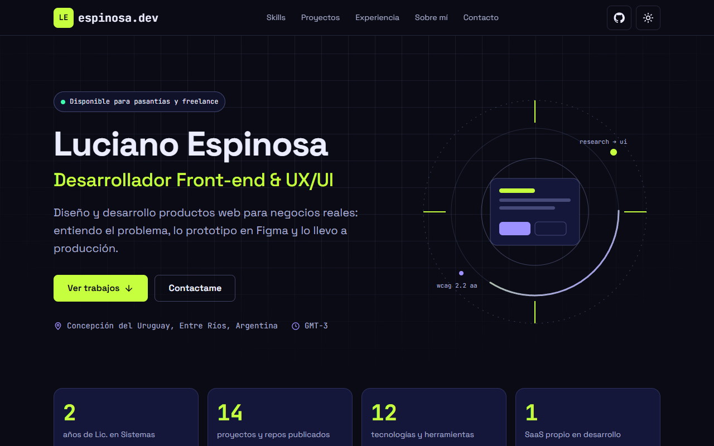
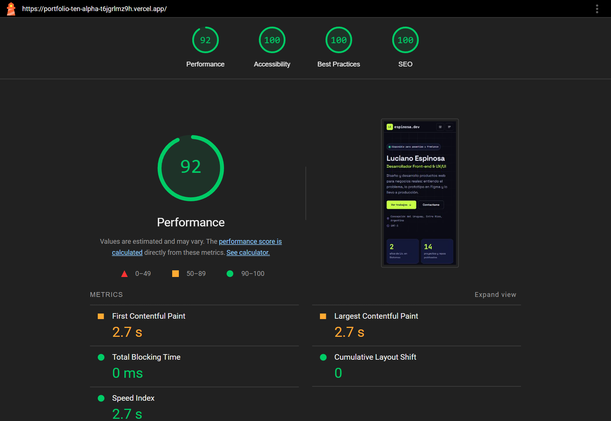

# Portfolio — Luciano Espinosa

Portfolio web personal · Trabajo Final de **Diseño UX-UI 2026** · Lic. en Sistemas de Información, FCyT (Sede Concepción del Uruguay).

| | |
|---|---|
| 🌐 **Sitio** | https://SITIO.netlify.app |
| 🎨 **Figma** | https://www.figma.com/design/XXXX (research, wireframes, design system y prototipo) |
| 📦 **Repo** | https://github.com/lucianoespinosa72/portfolio |



## Stack

- **HTML5 semántico** (`header`, `nav`, `main`, `section`, `article`, `footer`)
- **CSS3 puro** con variables en `:root` (design system "Neon Grid"), Flexbox y CSS Grid, mobile-first
- **JavaScript vanilla** (menú mobile, toggle claro/oscuro, link activo, animación de aparición)
- **Netlify**: deploy continuo desde `main`, Netlify Forms para el formulario y headers de seguridad
- Sin frameworks JS ni constructores visuales.

## Estructura

```
├── index.html          # One-page: hero, métricas, skills, proyectos, experiencia, sobre mí, contacto
├── caso-estudio.html   # Caso de estudio completo de TurnoYa (problema → proceso → solución → resultado)
├── 404.html            # Página 404 personalizada
├── gracias.html        # Confirmación del formulario
├── css/styles.css      # Design system + estilos
├── js/main.js          # Interacciones
├── img/                # Mockups SVG, retrato, favicon, imagen Open Graph
├── docs/proceso-ux.md  # Proceso UX: usuario, benchmark, concepto, arquitectura, test
└── netlify.toml        # Config de deploy, 404 y headers
```

## Design system

| Token | Oscuro | Claro | Uso |
|---|---|---|---|
| `--bg` | `#0a0b14` | `#f4f5fb` | Fondo |
| `--surface` | `#14173a` | `#ffffff` | Tarjetas |
| `--text` | `#eceeff` | `#0f1124` | Texto principal |
| `--text-muted` | `#a8adcf` | `#474c6b` | Texto secundario |
| `--primary` | `#c6ff3d` | `#4535d6` | CTA, acentos |
| `--secondary` | `#9d90ff` | `#4d5d00` | Etiquetas, detalles |

- **Tipografías (2):** Space Grotesk (texto y títulos) + JetBrains Mono (datos, etiquetas), con `font-display: swap`.
- **Escala tipográfica:** 1.25 (12 · 14 · 16 · 20 · 25 · 31 · 39 · 49 · 61 px).
- **Espaciado:** múltiplos de 4 (4 · 8 · 12 · 16 · 24 · 32 · 48 · 64 · 96 px).
- **Breakpoints:** base 375 px · 768 px · 1024 px (nav) · 1280 px.

## Accesibilidad y performance

- Contraste AA verificado en ambos temas (WebAIM Contrast Checker).
- Navegable con teclado, `:focus-visible` en todos los interactivos, link "Saltar al contenido".
- Menú mobile con `aria-expanded` / `aria-controls`, cierre con `Esc`.
- Respeta `prefers-reduced-motion`.
- Imágenes vectoriales livianas con `width`/`height` y `loading="lazy"` debajo del pliegue.

**Lighthouse (mobile):**



## Deploy (Netlify)

1. Subir el repo a GitHub (`main`).
2. En [app.netlify.com](https://app.netlify.com) → **Add new site → Import an existing project → GitHub** → elegir el repo.
3. Build command: *(vacío)* · Publish directory: `.` (ya definido en `netlify.toml`).
4. **Deploy**. Cada `git push` a `main` vuelve a desplegar automáticamente (CI/CD).
5. En **Site configuration → Forms** habilitar la detección de formularios para recibir los mensajes de contacto.
6. Copiar la URL final acá arriba y en la descripción del repo en GitHub.

## Créditos y recursos

- Diseño y código propios, sin template de base.
- Fuentes: [Google Fonts](https://fonts.google.com) (Space Grotesk, JetBrains Mono).
- Íconos: dibujados a mano en SVG, inspirados en el estilo de [Lucide](https://lucide.dev) (ISC).
- Herramientas: Figma, WebAIM Contrast Checker, Lighthouse, Squoosh.

## Uso de IA

Se usó **Claude (Anthropic)** como asistente para generar la base del HTML, CSS y JS a partir de la consigna, y textos de ejemplo.
Revisión hecha por mí: reemplacé el contenido por mis datos reales, ajusté el diseño para que coincida con mi prototipo de Figma, verifiqué contraste, navegación con teclado y responsive en 375/768/1280 px, y corrí Lighthouse.
